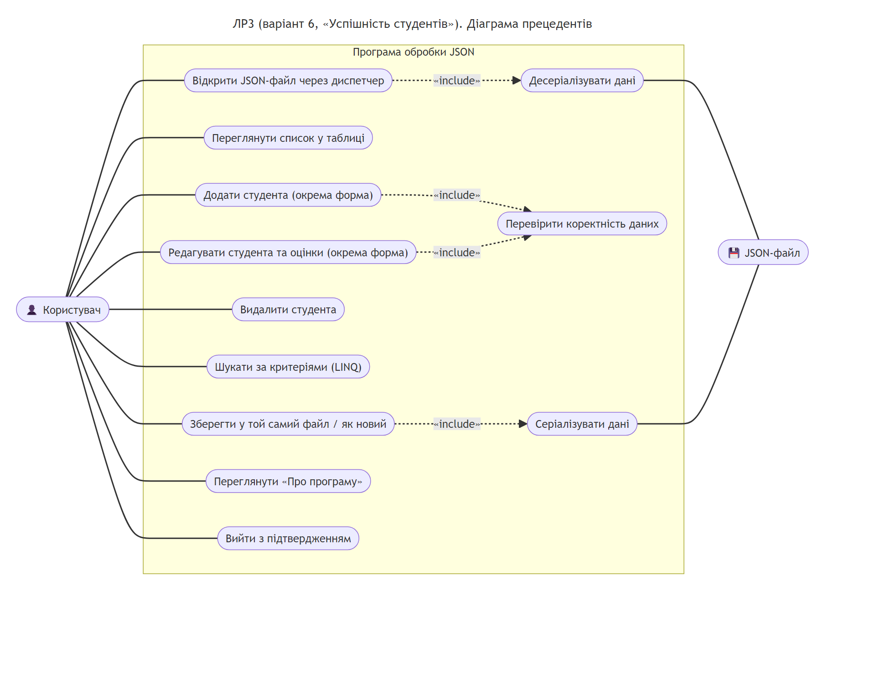
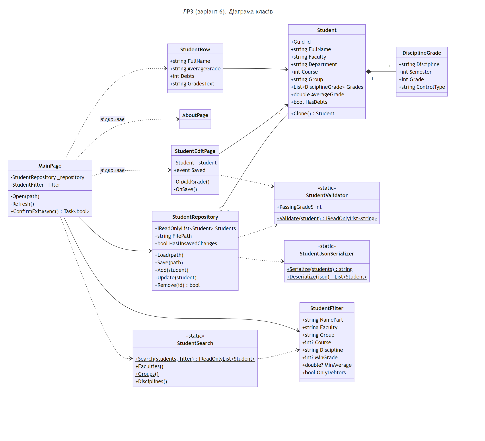
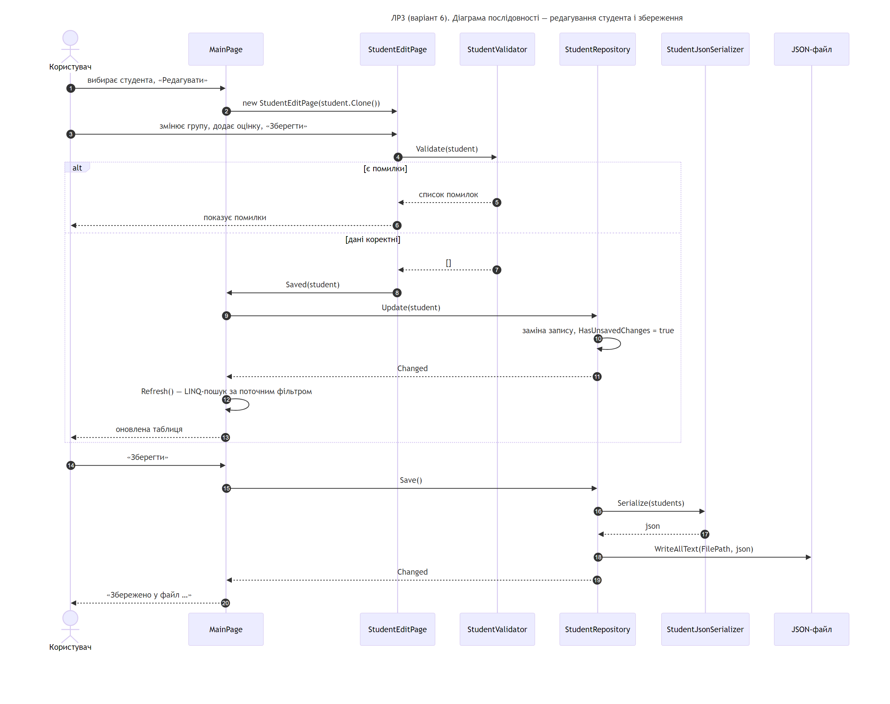

# Лабораторна робота №3 — Розробка програм обробки файлів у форматі JSON

Варіант 6: предметна область **«Успішність студентів»** (П.І.П., факультет, кафедра, курс, група, дисципліни та оцінки).

## Що реалізовано

- відкриття JSON-файлу через диспетчер файлів (`FilePicker`);
- десеріалізація і серіалізація списку студентів (`System.Text.Json`, `StudentJsonSerializer`);
- відображення даних у таблиці (Grid / `CollectionView`) з обчисленим середнім балом і кількістю заборгованостей;
- додавання і редагування через **окрему форму** (`StudentEditPage`) з перевіркою даних, видалення з підтвердженням;
- збереження в той самий (відкритий) файл або «Зберегти як…» у новий;
- пошук за допомогою **LINQ** (`StudentSearch`) за критеріями: частина П.І.П., факультет, група, курс,
  оцінка з дисципліни (не нижче заданої), середній бал (не нижче заданого), лише боржники;
  списки вибору містять лише значення, що є у файлі;
- форма **«Про програму»** (П.І.П., курс, група, рік, короткий опис), підтвердження виходу.

Логіка знаходиться в бібліотеці `StudentsJson.Core`, сторінки MAUI лише викликають її.

## Структура

| Проєкт | Призначення |
|---|---|
| `src/StudentsJson.Core` | Моделі, валідація, репозиторій, JSON-серіалізація, LINQ-пошук |
| `src/StudentsJson.App` | Інтерфейс .NET MAUI (Windows): таблиця, форма редагування, «Про програму» |
| `tests/StudentsJson.Core.Tests` | Unit-тести xUnit (10 тестів) |
| `data/students.json` | Приклад даних |
| `docs/uml` | UML-діаграми: прецедентів, класів, послідовності |

## Запуск

```bash
dotnet test tests/StudentsJson.Core.Tests
dotnet run --project src/StudentsJson.App -f net8.0-windows10.0.19041.0
```

Кнопка **«Демо-файл»** копіює `students.json` у `Документи\Lab3Json` і відкриває його.
П.І.П. для форми «Про програму» береться з файлу `src/StudentsJson.App/author.txt`.

## UML

| Прецеденти | Класи | Послідовність |
|---|---|---|
|  |  |  |
